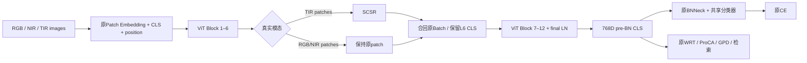

# 实验 A：UAD + SCSR-V3 实施与核查说明

本次按 `../../idea.md` 的完整方案实现，并按用户反馈恢复此前冻结的平滑有界残差公式。上一版将其替换为硬范数裁剪，属于实现偏差，不能称为“补全数学公式”；本版已纠正。没有训练或报告精度提升；本机没有 WHU-MARS 数据集、CUDA 环境，WHU 目录中也未发现 `.pth/.pt` 权重或训练 `.log` 文件。参考仓库中的其他任务日志不能代替 UAD 对照实验。

## 1. 修改前审查与论文依据

已阅读本地五篇论文正文、实验及消融，核对方法图和 FreqFiT/imgs/freqfit.png，并检查相应模块源码；以论文机制为准，再核对代码。

| 来源 | 论文机制与代码核对 | 本实验实际采用的部分 |
| --- | --- | --- |
| NS-FPN §3.1，式1–6 | 单级 DWT；LL 的空间注意力调制高频；阈值高斯过滤；IDWT。源码 `model/NS_FPN.py` 中先将高频按方向拼接，再以 `B,C,3,H,W` reshape，通道数大于1时顺序不能直接对应。 | 低频提供结构条件、分离并调整高频、逆变换。自行成对实现 Haar，不复制完整 LFP，也不引入 SFS/高斯过滤。 |
| FreqFiT §3，式1–4及图1 | Transformer 块间 FFT→学习滤波→IFFT→scale/shift残差。代码有1D与2D版本、复数与实数参数版本。 | 块间频率处理与残差接入；不冻结主干、不采用 FFT 滤波器或原论文 PEFT 策略。 |
| PFESA §2.1–2.2，式1–5 | **Gaussian 软频率掩码**分离频段，EA/SA统计注意力乘到原特征。论文存在 `Hh=1-Hl` 等表述歧义，源码使用互补掩码，并对低频能量计算均值与方差。 | 结构与细节共同作为条件；不照搬统计注意力或不明确的公式。方案对“固定FFT掩码”的描述应理解为固定 Gaussian 软掩码，而非硬截断。 |
| SFP §3.3–3.5，式4–11 | 比较 patch自注意与CLS对patch注意，识别异常；邻域替换；SAE与HAI。公开代码包含末层前top-10筛选及其他聚合，不能当作论文逐层SOM的直接等价实现。 | 中间层扰动可能通过后续注意力传播的动机；不硬筛选Token、不替换邻域、不改Attention。 |
| WHU-MARS §3.3、§4.2–4.5 | AS-ReID统一检索、PKM、共享ViT/BNNeck、ProCA停梯度中心、GPD原型与更新顺序。 | 全部沿用当前WHU实现。 |

这属于 SCSR-V3 新设计，不能称为四篇方法的直接复现，或声称已经证明它能去除 TIR 噪声。中层 Haar 高频也不是原图的物理频率，更不保证所有高频都是身份细节。

审查后保留：L6、TIR-only、768→192、四子带条件、64维瓶颈、双向高频增量、0.2残差、原四项损失。补全如下：

1. 恢复冻结V3的平滑有界残差公式，不使用硬裁剪、不对范数停梯度；零初始化仍能启动门控梯度。
2. 条件网络 Depthwise 卷积使用 **无偏置**，才能对应方案的383,616参数。
3. 采用显式成对 Haar；偶数网格下与 `pytorch_wavelets` 的 Haar/zero 相同，不增加生产依赖。
4. 全部 SCSR 参数采用主干基础LR，避免现有 `BIAS_LR_FACTOR=2` 将它的bias LR翻倍；其他参数策略原样保留。
5. SCSR 检查点附带实际配置，测试时验证路由及结构设置，防止误加载导致实验失效。

## 2. 最终网络与公式



标准配置每张图是129个Token：1个CLS、128个Patch。PatchEmbed的 `flatten(2).transpose(1,2)` 为行优先排列；网格来自实际 `num_y,num_x`，默认16×8。没有插值、无多层分解、无CLS直改。

对TIR的 `P ∈ R^(BT×128×768)`：

```text
Z = reshape(Wd(LayerNorm(P)))                  # BT×192×16×8
(LL,LH,HL,HH) = HaarDWT(Z)                     # 各 BT×192×8×4
Q = Conv1x1_64→576(GELU(DWConv3x3_64(GELU(
        Conv1x1_768→64(concat(LL,LH,HL,HH))))))
ΔHj = 0.5*tanh(Qj)*Hj                          # j = LH,HL,HH
D = HaarIDWT(0, ΔLH, ΔHL, ΔHH)
Δ = Wu(flatten(D))                            # BT×128×768
P'_b = P_b + 0.2*Δ_b / (1 + ||Δ_b||F/(||P_b||F + 1e-6))
```

`0.5*tanh(Qj)` 是增量系数；实际高频响应的乘数是 `1+0.5*tanh(Qj)`，范围(0.5,1.5)。有符号系数可增强或抑制，原高频为0时不直接生成新内容。LL只参与门控条件，不直接新增低频。

Haar在每个2×2单元 `[[a,b],[c,d]]` 上：

```text
LL=(a+b+c+d)/2; LH=(a+b-c-d)/2
HL=(a-b+c-d)/2; HH=(a-b-c+d)/2
```

逆变换按同一次序恢复，不混淆方向与通道。方向约定为LH高通沿高度，HL高通沿宽度，符合 [pytorch_wavelets官方文档](https://pytorch-wavelets.readthedocs.io/en/latest/dwt.html)。输入偶数尺寸，不需边界补点；正逆变换都是固定算子。

忽略epsilon时，令 `t=||Δ||F/||P||F`，实际更新比例为 `0.2*t/(1+t)`；t=0.1/0.5/1/2时分别约为0.01818/0.06667/0.1/0.13333。不存在t=1处的硬阈值，径向导数为 `0.2/(1+t)^2`，t>1时仍为正。实现保留范数计算图。

保留epsilon时，精确的渐近幅度上界为 `0.2*(||P||F+epsilon)`；忽略极小epsilon后才是输入范数的20%。IDWT低频增量为零，升维为逐位置无偏置线性映射，样本尺度因子对全部Token相同，所以直接残差仍有零LL性质。浮点运算及转回低精度有舍入误差；后续Attention/LN不保证继续保持零LL，也不保证最终CLS变化小于20%。这只是中层更新的约束。

投影权重正态初始化std=0.02；LN权重1/偏置0；前两层条件卷积非零Kaiming初始化；门控末层权重/偏置全零。没有额外可学习残差系数。首次前向严格恒等，首次反向主要门控末层启动，后续其他层逐步学习。模块在主干通用初始化之后注册，并保留CPU RNG状态，避免改变同种子的原分类器初始化。

参数：LN1,536 + 两个投影294,912 + 条件1×1 49,152 + DW3×3 576 + 末层36,864+576 = **383,616**。

DWT、条件网络、IDWT、投影及范数在关闭autocast的FP32域计算；最终残差转回原Token dtype。沿用原AMP及FP32 master weights，不应额外调用 `model.half()`。

## 3. 损失与检索

```text
L = L_CE + L_WRT + 0.01 L_ProCA + L_GPD
```

CE用最终CLS经BNNeck后的分类logits；WRT、ProCA、GPD全部用同一个增强后的最终pre-BN CLS。无频率损失、TIR分类器、辅助分支、重建损失。ProCA的停梯度身份中心、GPD τ=0.03、原型更新 `normalize(0.8*旧原型+0.2*新中心)`、先损失/优化后原型更新均原样保留。

统一检索仍使用768维pre-BN CLS及原L2归一化/距离/相机排除。TIR Query与Gallery都执行SCSR。`mode`保持原训练/评估路径含义；**不能作为传感器编号**。

训练 `imgs` 顺序由 `DATASETS.MODALITIES` 决定，模型建立对应1-based ID；默认RGB=1, IR=2, Thermal=3。评测从DataLoader真实 `modid` 创建Tensor，并传 `modal_ids`，以便DataParallel按图片切分。目标ID从模态名映射，不在SCSR内部写死。TIR样本提取后用非原地 `index_copy` 放回原位置；身份顺序不变。

RGB/NIR不调用SCSR，不代表训练阶段的RGB/NIR最终特征永不改变：共享主干、共享BN和跨模态损失仍联合学习。

## 4. 文件变更清单

| 文件 | 状态 | 功能及目的 |
| --- | --- | --- |
| `model/scsr.py` | 新增 | 成对Haar、四子带条件网络、高频增量、初始化、FP32有界残差、无图诊断统计。 |
| `model/backbones/vit_pytorch.py` | 修改 | Backbone正式注册SCSR；L6后调用；模态校验；保留CLS和原样本顺序；关闭时无新增参数。 |
| `model/make_model.py` | 修改 | PKM训练自动生成模态ID；测试独立modal_ids接口；目标名映射；检查点参数完整性及配置验证。 |
| `processor/processor.py` | 修改 | 验证和独立测试传真实modid；SCSR检查点保存同名`.pth.yml`；记录门控偏离1、残差比和显存；每epoch记录实际Batch、估计loader长度、实际optimizer更新、累计更新及AMP跳步。更新计数同时适用于UAD对照。 |
| `config/defaults.py` | 修改 | 增加SCSR配置，默认关闭，保留原UAD使用方式。 |
| `solver/make_optimizer.py` | 修改 | 仅SCSR参数取消bias加倍并使用基础LR和原普通weight decay；其他参数与原SGD/调度器不变。 |
| `configs/SCSR.yml` | 新增 | 复制当前UAD全部实验设置，只开启SCSR并分离输出目录。 |
| `tests/test_scsr.py` | 新增 | 12项无需数据集的数值与集成测试，包含归档原代码对照、平滑式与梯度、旧API缺失场景以及训练/保存/验证/重载调用链。 |
| `tests/check_scsr_ddp.py` | 新增 | 两进程CPU/Gloo梯度与参数同步检查，可在服务器运行。 |
| `docs/uad_before_scsr.zip` | 新增 | 修改前5个源码文件备份；本目录不是Git仓库，故保留归档便于审查/回退。 |
| `docs/scsr_changes.patch` | 新增 | 5个原文件的可审阅unified diff；新增文件直接查看源码。 |
| `docs/scsr_checks.txt` | 新增 | 最终CPU测试记录。 |
| `docs/SCSR_IMPLEMENTATION.md` | 新增 | 本说明，包括补全理由、结构、损失、运行与验证限制。 |

无文件删除。未改 `idea.md`、参考项目、原 `configs/UAD.yml`、`loss/`、`datasets/`、`utils/metrics.py`、`train.py/test.py` 或调度器。

工作区根目录 `tmp/` 还保留本次生成的论文文本/方法页图片、临时核验依赖及源码备份副本。清理该临时目录被自动审批拒绝，返回原因仅为 `blocked by policy`；这些文件不属于生产实现或新增运行依赖。

## 5. 运行方法与公平比较

在WHU目录执行；路径根据服务器实际位置修改。使用原ImageNet预训练ViT，120epoch、5epoch warmup、原cosine、SGD momentum0.9、weight decay1e-4、原梯度裁剪1.0。新增SCSR参数在创建优化器前已经注册，不使用旧训练完成的UAD权重追加微调。

单卡（B=64个采样位置，即16身份×4图×3模态=192张实际图像）：

```bash
CUDA_VISIBLE_DEVICES=0 python train.py --config_file configs/SCSR.yml \
  MODEL.DIST_TRAIN False SOLVER.IMS_PER_BATCH 64 SOLVER.BASE_LR 0.008 \
  DATASETS.ROOT_DIR /path/to/data MODEL.PRETRAIN_PATH /path/to/jx_vit_base_p16_224-80ecf9dd.pth \
  OUTPUT_DIR logs/SCSR_1000_single
```

四卡沿用本项目README的实际DDP逻辑与LR设置（全局采样256；每卡实际192张；全局基础LR0.032）：

```bash
CUDA_VISIBLE_DEVICES=0,1,2,3 torchrun --standalone --nproc_per_node=4 \
  train.py --config_file configs/SCSR.yml MODEL.DIST_TRAIN True \
  SOLVER.IMS_PER_BATCH 256 SOLVER.BASE_LR 0.032 \
  DATASETS.ROOT_DIR /path/to/data MODEL.PRETRAIN_PATH /path/to/jx_vit_base_p16_224-80ecf9dd.pth \
  OUTPUT_DIR logs/SCSR_1000_DDP
```

这里**没有修改或重新解释原DDP的全局batch/LR规则**。论文写每GPU基础LR0.008，当前README用线性放大0.032；本轮遵循方案“与当前对照实际配置一致”。若你的UAD对照实际使用其他LR，则两组实验都应采用那个实际设置，不应直接把不同预算/设置结果作比较。

独立测试及已有详细36域组合报告：

```bash
CUDA_VISIBLE_DEVICES=0 python test.py --config_file configs/SCSR.yml \
  MODEL.PRETRAIN_CHOICE none DATASETS.ROOT_DIR /path/to/data \
  TEST.WEIGHT logs/SCSR_1000_DDP/transformer_120.pth \
  TEST.NECK_FEAT before TEST.FEAT_NORM yes TEST.RE_RANKING False TEST.TOP_K_EVAL 0 \
  TEST.DETAILED_DOMAIN_EVAL True OUTPUT_DIR logs/SCSR_1000_DDP_eval
```

保存时会产生 `transformer_120.pth` 与 `transformer_120.pth.yml`，迁移必须一起复制。加载校验全部SCSR结构/幅度/目标名及模态排列、输入尺寸、stride、backbone和SIE设置；训练LR/输出目录允许在测试时不同。拒绝漏掉SCSR参数、无配置伴随文件或不一致配置；原无SCSR模型也拒绝加载带SCSR的权重。

对照运行用原UAD.yml，相同预训练、seed、batch、LR、epoch、数据版本与评测配置，分开输出目录。`configs/SCSR.yml SCSR.ENABLED False`也恢复原网络，但它的输出目录仍是SCSR目录，应显式改成独立对照目录。

上述 `DATASETS.DATASET_DIR`、`DATASETS.FILTER_GD` 和 `TEST.DETAILED_DOMAIN_EVAL` 是当前WHU工程已有的本地扩展，不应称为官方原版默认配置。已核对当前源码和修改前归档的 `defaults.py`：三个键均存在；`make_dataloader.py`实际传递dataset_dir/filter_gd，`whu_mars.py`实际处理路径和过滤，独立测试实际调用详细域评测。YACS合并这些参数通过。`train.py`（rank0）及`test.py`已有最终合并配置日志；上传服务器应包含当前完整WHU目录，而不只上传SCSR新增文件到另一份官方源码。

公平比较使用同一个WHU-MARS-1000划分和Query/Gallery，启用相同详细评测后对照CSV的 `query_count`、`gallery_count`、`valid_query_count`。共同保持pre-BN、L2归一化、无re-ranking、`TOP_K_EVAL=0`和原有同相机排除（排除该相机的全部Gallery样本）。没有修改metrics.py或其过滤算法。

PKM长度是估计值，不能用 `120*len(train_loader)` 代替真实更新次数。每epoch新增日志区分实际完成Batch、估计loader长度、实际optimizer更新、累计更新及AMP跳步。服务器反馈旧PyTorch没有 `register_step_post_hook`，已移除该依赖；改用长期存在的公开 `GradScaler.get_scale()`，在本项目单optimizer/default动态scale流程中，scale下降表示AMP跳步，不变或增长表示成功更新，AMP禁用时每步正常计数。可参照[PyTorch 1.10.2官方实现](https://github.com/pytorch/pytorch/blob/v1.10.2/torch/cuda/amp/grad_scaler.py)。每步读取一次新scale会产生CPU/GPU同步，不改变训练算子或增加跨卡通信。DDP记录rank0本进程次数，**不是次数再乘卡数**。对照UAD也运行同一份processor以保留这些日志；先核对预训练、seed、采样、LR、Batch及真实更新预算，再比较结果。不得将LR0.032的SCSR与另一套LR/预算的UAD直接计算增量。

2337版本沿用原 `DATASETS.DATASET_DIR WHU-MARS-2337`；GD评估用 `DATASETS.FILTER_GD True`。这些都不改变频率模块或统一评测。已有评测会输出整体、9模态对以及详细域协议；未新增或改变任何评测过滤规则。硬件成本方面可从原step耗时和新增显存日志记录，并在服务器实际测量TIR推理延迟，不用CPU时间代替GPU推理性能。

## 6. 已完成的本地验证与限制

环境：Windows、Python3.9、PyTorch2.8.0+cpu（不同于项目requirements中的2.2.2）。生产requirements未修改。没有数据集或GPU完整训练。

运行：

```bash
python -m unittest discover -s tests -p test_scsr.py -v
python tests/check_scsr_ddp.py
```

12项CPU测试通过，耗时及完整结果见同目录 `scsr_checks.txt`：

更新计数兼容性修复后，提取并直接执行processor中的实际AMP更新/计数代码：有限梯度、Inf梯度、有限梯度三次尝试的累计次数依次为1、1、2；同时覆盖scale增长以及AMP禁用情形。检查确认源码不再依赖optimizer step hook。该检查在本地新PyTorch CPU执行，并核对了旧版1.10.2公开API源码；不等同于已在服务器实际PyTorch/CUDA环境完成训练。

- Haar正逆可逆、能量守恒、双精度梯度检查及已知2×2有符号方向。
- 参数数383,616；首次输出严格恒等；4次更新中门控先启动，后续所有可训练参数获得有限非零梯度。
- 直接核对冻结平滑式在t=0.1/0.5/1/2的比例、t>1非零径向梯度、delta=0的0.2初始导数及双精度梯度检查。
- 强制放大升维权重后，完整模块输出与平滑算子一致，残差比例平滑接近0.2；直接残差LL误差<1e-6；零输入稳定。
- CPU autocast与float32/bfloat16/float16 Token输出dtype及有限值检查。
- **完整12层、768维ViT**与备份原UAD同种子权重和前向严格一致；开启零初始化严格一致；非零门控只改变TIR推理输出。
- L6调用位置、CLS保留、混合顺序散回、PKM模态标识与输入顺序检查。
- 模态顺序改变时目标ID正确；缺失、错长、越界、浮点及bool模态编号拒绝。
- 192实际图像→192×768特征，SCSR只收到64×128×768的TIR Patch。此大Batch检查用缩小FFN的8层测试主干降低CPU开销；完整12层已在小Batch单独验证。
- 原CE/WRT/ProCA/GPD逐项回传到SCSR门控；原型更新、优化器注册与SCSR bias基础LR检查。
- 保存/重载特征严格一致；关闭架构、残差幅度不匹配、缺失SCSR参数均拒绝。
- 模拟缺失统一 `torch.autocast` / CPU AMP接口仍可运行SCSR的FP32 CPU路径；CUDA路径明确采用原UAD的 `torch.cuda.amp.autocast(enabled=False)`，其[PyTorch 1.8.2官方源码](https://github.com/pytorch/pytorch/blob/v1.8.2/torch/cuda/amp/autocast_mode.py)已有该接口。
- 旧optimizer对象显式禁止 `register_step_post_hook`，执行实际do_train函数的两Batch训练、四项损失、原型更新、保存参数/配置、真实统一验证与重载。仅将CUDA设备和CUDA服务改为CPU/桩，其他控制流程保留。此项不代表真实CUDA AMP或多进程验证通过。

兼容性复审还移除了测试脚本的 `with_kwargs` Hook参数；对10个生产/测试Python文件完成Python3.8语法检查，PCA/GPD/PrototypeBank与原备份AST一致。模拟旧 `torch.load` 拒绝 `weights_only` 参数后成功走现有TypeError回退，并确认全部检索参数恢复一致（测试加载仍沿用原UAD跳过分类器的约定）。原requirements未改动，服务器无需为本次修复重装环境；没有获知服务器确切PyTorch版本，也未在该服务器环境实测，不能宣称覆盖所有旧版本。

另外用临时隔离的NumPy/PyWavelets/pytorch_wavelets库独立验证 `2×192×16×8`：四子带与库结果最大差均4.77e-7；库IDWT与本实现IDWT差4.77e-7。这些库仅用于核对，不是SCSR运行依赖。

两进程DDP脚本**未能完成**：本机Gloo初始化报 `makeDeviceForHostname(): unsupported gloo device`，发生在模型创建前。本地PyTorch存在相同类别的[官方问题记录](https://github.com/pytorch/pytorch/issues/150381)。不能将其当作模型同步通过。脚本保留供支持Gloo的服务器验证，包含每卡PKM式混合模态和一张卡没有TIR的情况。

原CUDA/NCCL DDP包装（`find_unused_parameters=True`）、PKM分卡、ProCA/GPD通信、验证buffer广播与按模态分配rank全部原样保留；SCSR不引入跨卡通信。服务器仍需核验真实CUDA AMP、NCCL多卡、真实数据增强/训练、吞吐/显存/TIR延迟以及最终检索指标。

建议服务器先用原命令跑数步并验证一次，再进行完整120epoch。不要仅凭本地合成检查或训练Loss下降判断模块有效；重点比较整体AS-ReID、TIR同模态、跨模态及跨平台指标。

## 7. 已训练检查点的四项诊断

新增独立入口 `diagnose_scsr.py` 和 `diagnostics/`，运行方式、六类CSV/JSON输出及精度/梯度解释见同目录 [SCSR_DIAGNOSTICS.md](SCSR_DIAGNOSTICS.md)。两处模型代码仅增加默认关闭的无参数callbacks及eval-only的SCSR runtime旁路，参数数量和正常训练前向不变。原普通检索加载器仍跳过分类器；新诊断加载器单独严格恢复完整分类器，避免CE探针使用随机分类头。

原12项回归与新增6项诊断测试合计18项通过，包含合成JPEG的六文件完整输出、原检索协议一致性与参数/BN状态hash不变。记录见 `scsr_diagnostic_checks.txt`。真实120epoch检查点与数据不在本机，本地测试不能代替服务器上的实际诊断结果。
