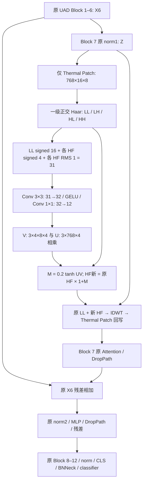

# SCSR-V4.1 实施与运行说明

本次以新复制的原 UAD `WHU/` 为底座，实现 `idea2.md` 中冻结的 V4.1。`WHU_v3/` 的网络、日志和诊断结果保持原样。原 `configs/UAD.yml` 不变；新增 `configs/SCSR_V41.yml`，默认仍使用单卡协议，四卡通过命令覆盖原 UAD 的分布式、Batch 和 LR 设置。

## 方案审查与补齐的细节

1. **插入位置与残差**：仅 `blocks[6]` 使用原 Block 的子类。调制 `norm1(X6)` 的 Thermal Patch，原残差使用 `X6`，其他 11 个 Block 的原 `Block.forward` 未改。没有迁入 V3 的双投影、额外归一化、Patch 残差公式或第二个融合尺度。
2. **模态与顺序**：训练按照 `DATASETS.MODALITIES` 的现有 PKM 分组生成真实逐样本传感器 ID；推理从数据集的 `modid` 生成 Long Tensor，支持原 DataParallel 的正确切分。`mode` 继续只控制训练/推理接口。没有重排图像、身份或采样器。
3. **初始化校准**：在 ImageNet 权重加载后、创建优化器前执行一次固定真实 PKM Batch 检查。直接选取 Dataset 索引并使用原训练增强，不迭代训练采样器；保存/恢复 Python、NumPy、CPU 及当前 Rank GPU 的 RNG，使用 eval/no_grad 保持 BN 和 Dropout 状态。不会为了保存 RNG 在其他 Rank GPU 上创建 CUDA 上下文。
4. **一次性尺度修正**：若全局 RMS 不符合 V≈0.05–0.10、UV 同量级参考，仅允许整体缩放最终 `32→12` 输出卷积一次。选择让 V/T 均落在该区间的比例，然后重测；不能满足或出现明显饱和、不可读变化时直接报错，不继续改 U、门控幅度或网络。数值区间只是初始化参考，不在训练中强行维持。有效初始化 std、调整倍率、固定样本路径、RNG 种子和读数另存 JSON，避免把实际调整后的 std 继续描述成 0.02。
5. **信息传播检查**：初始化和前 200 个有效更新内的稀疏日志，同时在相同小 Batch 上测 AMP 与 FP32 的 ON/OFF 注意力输入、注意力输出和最终 CLS；不会频繁检索整个 Gallery。梯度记录在 AMP unscale 后、裁剪前后各一次，参数变化比较真实 step 前后以及相对初始值，包含实际改变元素比例。相对变化按范数除以参考范数加 EPS 计算；训练 forward 统计是 Rank 0 的本地 Batch，参数梯度来自原 DDP 规约；初始化全局 RMS 则汇总等样本量的所有 Rank。
6. **优化器与旧版本**：所有 7 个 SCSR 参数张量放入一个 SGD 参数组，LR 为原 BASE_LR、WD=0；原分类器和 bias 的规则不变。步数根据单一优化器的 GradScaler scale 是否下降统计，不使用 `register_step_post_hook`。使用 PyTorch 1.12 的 CUDA AMP API，没有新增安装依赖。ViT 转换为频率图后显式使用连续 NCHW，并记录参数/梯度 stride，便于核查旧 cuDNN/DDP 的 1×1 卷积梯度布局警告；本地不能保证目标 GPU 不再出现该警告。
7. **Checkpoint**：保留原模型 `state_dict` 的 `.pth` 格式，新增同名 `.pth.json` 元信息。V4.1 加载需版本、架构、模态顺序、网格和校准信息匹配，且 state_dict 完整。普通测试保持原 UAD 跳过 classifier 的行为；CE/WRT 梯度诊断严格恢复训练后的 classifier。正式训练拒绝用训练完的 UAD/V3/V4.1 模型充当 ImageNet 初始化，并记录实际预训练文件 SHA256 和初始化种子。
8. **短期预检**：可用 `PREFLIGHT_UPDATES=200` 在 200 次有效更新后保存并退出，仍使用完整 120 Epoch 调度器，避免改 MAX_EPOCHS 后改变短期训练协议。正式实验重新从相同 ImageNet 权重和种子开始，预检权重不作为正式训练起点。

## 模型与数学定义

输入图像 256×128，原 ViT-B/16 输出 128 个 Patch 和 1 个 CLS，通道为 768。



设 `a,b,c,d` 是每个 2×2 格点的左上、右上、左下、右下值：

\[
LL=(a+b+c+d)/2,\quad LH=(a+b-c-d)/2,
\]
\[
HL=(a-b+c-d)/2,\quad HH=(a-b-c+d)/2.
\]

其中 LH 为高度方向高频、HL 为宽度方向高频；方向由公式定义，不依赖外部库的名称约定。

每个方向的能量通道为 `sqrt(mean(H_j², channel)+1e-6)`。各 signed 投影互相独立且无激活；拼接之后才使用空间卷积和 GELU。

\[
V\in\mathbb R^{B_T\times3\times4\times8\times4},\quad
U\in\mathbb R^{3\times768\times4},
\]
\[
T_{b,j,c,h,w}=\sum_{r=1}^{4}U_{j,c,r}V_{b,j,r,h,w},\quad
M=0.2\tanh(T),\quad H'_j=(1+M_j)H_j.
\]

Rank-4 描述的是 T 的因子分解；逐元素 tanh 后的 M 不必仍有矩阵秩 4。

\[
Z'_P=\operatorname{IDWT}(LL,H'_{LH},H'_{HL},H'_{HH}),
\]
\[
Y=X_6+\operatorname{DropPath}(\operatorname{Attention}(Z')),
\quad X_7=Y+\operatorname{DropPath}(\operatorname{MLP}(\operatorname{norm2}(Y))).
\]

Z 的 CLS 和非 Thermal 样本原样保留。内部 Haar、条件网络、UV、tanh、IDWT 使用 FP32，回写到原 norm1 输出 dtype。理想实数运算下，`||Z'_P−Z_P||F ≤ 0.2 ||HF||F ≤ 0.2 ||Z_P||F`；浮点重建/类型转换需要数值容差，该界不约束后续 Attention 或 CLS。

| 新增参数 | 数量 |
| --- | ---: |
| LL 1×1 Conv 768→16 | 12,288 |
| 三个独立 HF 1×1 Conv 768→4 | 9,216 |
| 3×3 Conv 31→32 | 8,928 |
| 输出 1×1 Conv 32→12 | 384 |
| U：3×768×4 | 9,216 |
| 合计，无 bias | **40,032** |

LL/HF/空间卷积使用 Kaiming normal（fan_in、linear，保留有符号线性投影）；输出权重初始 normal std=0.02，U normal std=0.5。均非零初始化。创建新模块时保护 RNG，原主干和外部 classifier 的初始化与原 UAD 一致。主干继续训练，没有采用 AdaptFormer 冻结主干的训练设置。

## 损失与评测协议

\[
\mathcal L=\mathcal L_{CE}+\mathcal L_{WRT}+0.01\mathcal L_{ProCA}+\mathcal L_{GPD}.
\]

没有新增损失。CE 使用原共享 BNNeck/classifier；WRT、ProCA 和 GPD 使用原 pre-BN CLS。ProCA 的身份中心继续 stop-gradient，GPD 温度为 0.03、原型更新新中心权重为 0.2，原型 all_gather 和 AMP 跳步时的原型更新语义均保持原 UAD。

统一、九模态和 36 域评测继续使用原 `utils/metrics.py`，保持 pre-BN、L2、无 reranking、TOP_K_EVAL=0，排除 Query 同相机的全部 Gallery。比较 UAD 与 V4.1 时必须保持数据划分、预训练、随机种子、采样器、LR、Batch 和实际有效更新数一致。

## 文献与本方案的边界

- [WHU.pdf](../WHU.pdf)，§4.2–4.5（PDF 第 5–6 页）：直接保留主干、BNNeck、PKM、CE/WRT、ProCA 和 GPD，以及同相机排除协议。
- [NS-FPN.pdf](../NS-FPN.pdf)，§3.1（PDF 第 3–4 页）：借鉴 DWT、低频引导高频处理、IDWT；没有复制 Sigmoid 空间图或第二阶段 Gaussian 过滤。
- [FreqFiT.pdf](../FreqFiT.pdf)，§3（PDF 第 3–4 页）：借鉴 ViT 频域适配；没有迁入 FFT 滤波器、缩放/平移或 Block 间残差路径。
- [PFESA.pdf](../PFESA.pdf)，§2.1–2.2（PDF 第 3–5 页）：借鉴频带互补统计；没有复制其 FFT/Gaussian 或参数免费注意力公式。
- [AdaptFormer.pdf](../AdaptFormer.pdf)，§3.2 / Figure 2 / §4.1（PDF 第 4–5 页），对应代码 `AdaptFormer/models/adapter.py` 与 `custom_modules.py`：借鉴预训练 Transformer 的轻量适配原则。论文采用并行 FFN Adapter，up-projection 零初始化；代码 down 初始化用 Kaiming uniform，而论文描述 Kaiming normal。本实验遵循 V4.1 的非零初始化和注意力输入融合，不把它说成 AdaptFormer 原结构的复现。
- [SFP.pdf](../SFP.pdf) 的 SOM/SAE/HAI 没有被新方案采用；V4.1 不加入 outlier 替换或新的 attention 算子。

Rank-4 条件网络、非对称非零初始化和第 7 层 TIR-only Attention 输入调制是 `idea2.md` 的任务组合设计。

## 修改文件清单

| 修改原文件（6 个） | 新增行为 / 目的 |
| --- | --- |
| `config/defaults.py` | 新 SCSR_V41 配置、默认关闭；诊断和预检开关 |
| `model/backbones/vit_pytorch.py` | 仅第 7 层子类接入；RNG 保护；正确 norm1/attention/CLS 采集；限制预训练来源 |
| `model/make_model.py` | 保持原输出契约，传真实模态 ID，检查 PKM 分组，加载新版本权重 |
| `solver/make_optimizer.py` | SCSR 单独 LR=BASE_LR、WD=0；检查参数完整且不重复 |
| `processor/processor.py` | 推理模态 ID、真实 step/AMP skip 统计、稀疏监测、sidecar、可选 200-step 退出 |
| `train.py` | 优化器前真实 Batch 校准、保存最终合并配置 |

| 新文件 | 功能 |
| --- | --- |
| `model/scsr_v41.py` | 全新 40,032 参数频域调制模块和正交 Haar |
| `configs/SCSR_V41.yml` | 与原单卡 UAD 对齐的 V4.1 配置 |
| `utils/scsr_v41_runtime.py` | 不消耗采样器的初始化校准、RNG/BN 保护和小 Batch ON/OFF |
| `utils/scsr_v41_monitor.py` | 真实梯度/参数更新及 AMP/FP32 差异日志 |
| `utils/scsr_v41_checkpoint.py` | 版本和架构校验、校准元信息、旧 torch.load 兼容 |
| `diagnose_scsr_v41.py` | 一个入口执行同权重 ON/OFF、内部统计、逐层差异、CE/WRT 梯度和检索变化 |
| `diagnostics/core.py` | 新 norm1/attention 采集位置与梯度诊断 |
| `diagnostics/data.py`, `diagnostics/retrieval.py`, `diagnostics/__init__.py` | 从 V3 复用固定样本选择、逐 Query 全排序工具；不依赖 V3 网络 |
| `tests/test_scsr_v41.py` | CPU 数学、完整网络等价、路由、梯度/实际 SGD、版本/协议自检 |
| `tests/fixtures/uad_vit_original.py`, `uad_make_model_original.py` | 本次修改前的原 UAD 源码，仅供独立比对；生产不导入 |
| `SCSR_V41_IMPLEMENTATION.md`, `SCSR_V41_VALIDATION.md` | 实施细节、完整文件清单、运行方法及检查证据 |

没有删除原文件。原数据加载/增强、PKM/PKM_DDP、损失源码、原型逻辑、scheduler、统一/详细 metrics、原 `UAD.yml` 和 `test.py` 均保留。原始源码归档和审查 diff 位于工程根 `tmp/v41_original/`；服务器运行只需要上传完整 `WHU/`。

## 服务器命令

以下命令在服务器 **WHU 目录内**执行。每条命令是一整行，避免 Bash 反斜杠后的空格或换行导致 YACS 参数缺值。数据目录示例为 `/project/code/data/WHU-MARS`；预训练文件若不在当前目录，替换 `MODEL.PRETRAIN_PATH` 的实际路径即可。继续使用已能运行 UAD 的 clipreid 环境，不要求升级 PyTorch。

四卡正式训练（逻辑 GPU 0–3；默认 120 Epoch）：

```bash
CUDA_VISIBLE_DEVICES=0,1,2,3 torchrun --standalone --nnodes=1 --nproc_per_node=4 train.py --config_file configs/SCSR_V41.yml MODEL.DIST_TRAIN True MODEL.PRETRAIN_PATH jx_vit_base_p16_224-80ecf9dd.pth DATASETS.ROOT_DIR /project/code/data DATASETS.DATASET_DIR WHU-MARS DATASETS.FILTER_GD False SOLVER.IMS_PER_BATCH 256 SOLVER.BASE_LR 0.032 OUTPUT_DIR ./logs/SCSR_V41_1000_4gpu
```

每卡 64 个采样位置 × 3 模态 = 192 张图，四卡合计 768 张图。正式四卡 UAD 基线应使用同样的 IMS_PER_BATCH=256、BASE_LR=0.032、种子和训练协议，并以 `configs/UAD.yml` 关闭新模块。

单卡训练沿用配置中的 IMS_PER_BATCH=64、BASE_LR=0.008：

```bash
CUDA_VISIBLE_DEVICES=0 python train.py --config_file configs/SCSR_V41.yml MODEL.DIST_TRAIN False MODEL.PRETRAIN_PATH jx_vit_base_p16_224-80ecf9dd.pth DATASETS.ROOT_DIR /project/code/data OUTPUT_DIR ./logs/SCSR_V41_1000_1gpu
```

建议先跑 200 次有效更新预检；它是可选短期验收，不是正式训练的接续阶段。其参数与正式四卡训练相同，只增加退出条件和独立输出目录：

```bash
CUDA_VISIBLE_DEVICES=0,1,2,3 torchrun --standalone --nnodes=1 --nproc_per_node=4 train.py --config_file configs/SCSR_V41.yml MODEL.DIST_TRAIN True MODEL.PRETRAIN_PATH jx_vit_base_p16_224-80ecf9dd.pth DATASETS.ROOT_DIR /project/code/data DATASETS.DATASET_DIR WHU-MARS DATASETS.FILTER_GD False SOLVER.IMS_PER_BATCH 256 SOLVER.BASE_LR 0.032 SCSR_V41.PREFLIGHT_UPDATES 200 OUTPUT_DIR ./logs/SCSR_V41_preflight_4gpu
```

审查 `config_merged.yml`、各 Rank 的 `scsr_v41_init_rank*.json` 和 Rank 0 的 `scsr_v41_training_diagnostics.jsonl`：检查 V/T 初始尺度、饱和、真实 dtype、注意力/CLS 变化、各层梯度、step_relative/changed_fraction/from_init_relative，以及有效步数/AMP skip。预检 `.pth` 仅供诊断；正式命令仍从 ImageNet 开始。

正式测试（统一评测及原 36 域报告；无需 DDP）：

```bash
CUDA_VISIBLE_DEVICES=0 python test.py --config_file configs/SCSR_V41.yml MODEL.PRETRAIN_CHOICE none MODEL.DIST_TRAIN False DATASETS.ROOT_DIR /project/code/data DATASETS.DATASET_DIR WHU-MARS DATASETS.FILTER_GD False TEST.WEIGHT ./logs/SCSR_V41_1000_4gpu/transformer_120.pth TEST.DETAILED_DOMAIN_EVAL True TEST.TOP_K_EVAL 0 OUTPUT_DIR ./logs/SCSR_V41_1000_4gpu/test
```

测试必须同时保留 `transformer_120.pth` 和 `transformer_120.pth.json`。同权重普通 OFF 测试在上述命令加 `TEST.SCSR_V41_RUNTIME_ENABLED False`，并使用不同 OUTPUT_DIR。不要把 `SCSR_V41.ENABLED` 设 False 来加载 V4.1 权重；那会改变模型结构。

完整诊断一次执行全部任务，默认 FP32，输出目录必须为空：

```bash
CUDA_VISIBLE_DEVICES=0 python diagnose_scsr_v41.py --config_file configs/SCSR_V41.yml --checkpoint ./logs/SCSR_V41_1000_4gpu/transformer_120.pth --output-dir ./logs/SCSR_V41_1000_4gpu/diagnostics_fp32 --device cuda:0 DATASETS.ROOT_DIR /project/code/data
```

`--skip-retrieval` 仅用于快速激活/梯度检查；`--amp --loss-scale 65536` 可另存目录比较 AMP 梯度（输出已除回诊断 scale，记录非有限值，不自动把它认定为有效学习）。诊断使用相同 Query/Gallery 及同相机过滤，全 Gallery 排序计算 AP；不以 Top-K 近似 mAP。整体、9 个模态对和 TIR 的 4 个跨平台对分别统计。ON/OFF 是同一 V4.1 权重的因果检查，不能替代独立训练 UAD 基线。

本地 CPU 自检：

```bash
python -m unittest discover -s tests -p test_scsr_v41.py -v
```
